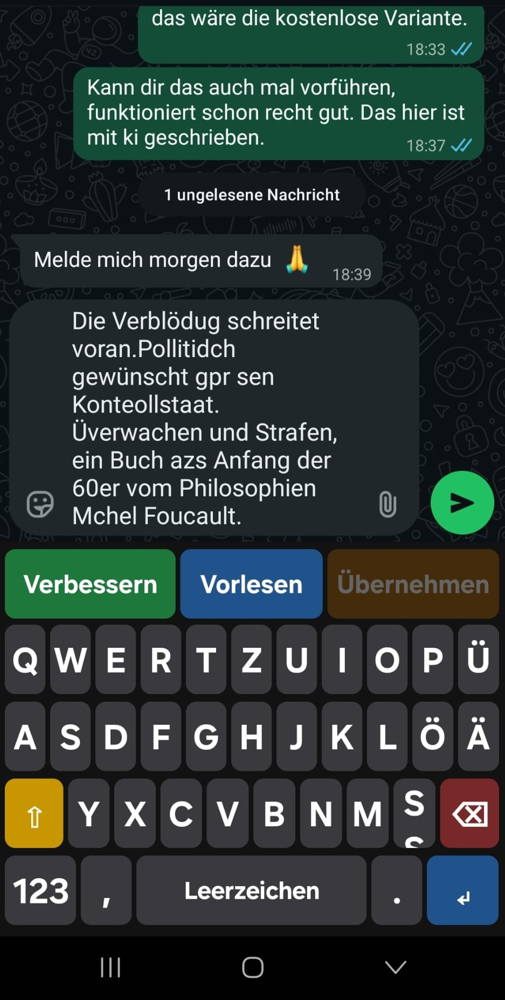
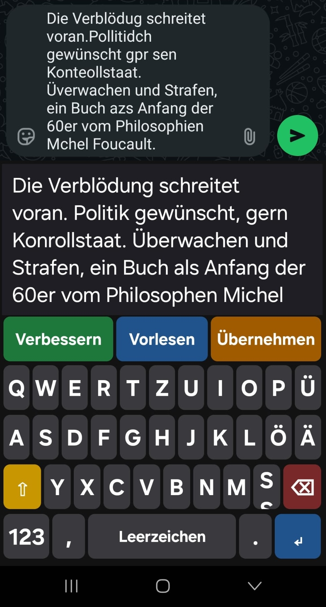
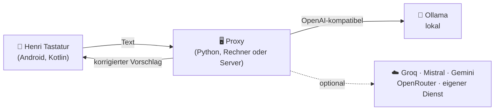
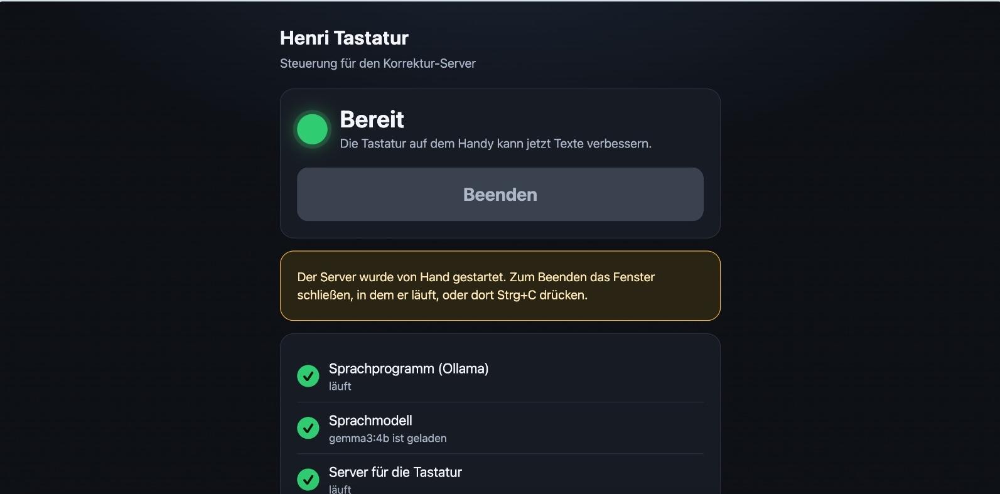

<div align="center">

# ⌨️ Henri Tastatur

**Die Android-Tastatur, die mitdenkt: tippen, korrigieren lassen, vorlesen lassen, selbst senden.**

Für Menschen, die schlecht sehen und beim Tippen viele Fehler machen. Funktioniert in jeder App.

[](LICENSE)
[](https://github.com/mibah/henri_keyboard/releases)


[Schnellstart](#-schnellstart) · [So funktioniert es](#-so-funktioniert-es) · [Einstellungen](#-einstellungen-in-der-handy-app) · [Bauen](#-app-bauen) · [Releases](https://github.com/mibah/henri_keyboard/releases)

</div>

> Hinweis: Der Code dieses Projekts wurde mit Hilfe von Claude (KI-Assistent von Anthropic) erzeugt.

---

## ✨ Worum es geht

Wer schlecht sieht, tippt Nachrichten oft voller Buchstabendreher und Tippfehler, kann sie aber kaum noch
kontrollieren. **Henri** korrigiert die Nachricht mit einem Sprachmodell, zeigt den Vorschlag **groß** an
und **liest ihn vor**. Gesendet wird nie automatisch: Die Entscheidung bleibt beim Nutzer.

Die Tastatur ist ein ganz normales Eingabemethoden-Modul. Sie arbeitet deshalb in **WhatsApp, Signal, SMS,
E-Mail und jeder anderen App**, ohne Zugriff auf die Messenger selbst.

## 📱 So sieht es aus

<div align="center">

| 1. Getippt (mit Fehlern) | 2. Nach „Verbessern“ |
|:---:|:---:|
|  |  |
| Große, kontrastreiche Tasten und drei Knöpfe: **Verbessern**, **Vorlesen**, **Übernehmen**. | Der Vorschlag steht in großer Schrift da und wird vorgelesen. **Übernehmen** setzt ihn ins Feld. |

</div>

## 🔁 So funktioniert es

1. **Tippen** (oder diktieren) mit der Henri Tastatur.
2. **Verbessern**: Der Text geht an den Proxy, das Modell korrigiert Rechtschreibung und Zeichensetzung.
3. Der Vorschlag erscheint **groß** und wird **vorgelesen** (Android-TTS).
4. **Falsches Wort im Vorschlag?** Antippen markiert es gelb, nochmal antippen holt ein anderes
   (Kandidaten vom Server, `/reword`). Danach wird ab diesem Satz weitergelesen.
5. **Mehrere Wörter?** Lange drücken (die Markierung blinkt und wird grün) und über die Wörter ziehen.
   Antippen der grünen Stelle holt andere Formulierungen (`/rephrase`, eigener Prompt
   `proxy/prompt_passage.txt`).
6. **Übernehmen** ersetzt den Feldtext. **Gesendet wird nie automatisch.**

In Passwortfeldern sind die KI-Funktionen ausgeblendet.



## 🖥️ Steuerung am Rechner

Ein Doppelklick genügt: `Start-Henri.command` (Mac) oder `Start-Henri.bat` (Windows) öffnet eine
Steuerungsseite im Browser mit Start/Beenden-Knopf, Statusanzeige und der Wahl des Sprachmodell-Anbieters.
Sie ist bewusst einfach gehalten, mit großer Schrift und klaren Farben.

<div align="center">

</div>

## 🚀 Schnellstart

1. **Ollama** und **Python 3** auf dem Rechner installieren.
2. `Start-Henri.command` bzw. `Start-Henri.bat` doppelt anklicken und in der Steuerungsseite auf **Starten** drücken.
3. Die **APK** aus den [Releases](https://github.com/mibah/henri_keyboard/releases) auf dem Handy installieren,
   die Tastatur in den Android-Einstellungen aktivieren und in der Henri-App die Adresse des Rechners eintragen.

Ausführliche Anleitung mit allen Schritten: **[QUICKSTART.md](QUICKSTART.md)**

## 🧩 Aufbau

| Ordner | Inhalt |
|---|---|
| `keyboard/` | Android-App (Kotlin, ohne Fremdbibliotheken): Tastatur und Einrichtungs-Activity |
| `proxy/` | Dünner HTTP-Proxy (Python, nur Standardbibliothek) vor einer OpenAI-kompatiblen LLM-API, dazu die Steuerungsseite |
| `tests/` | Testreihe für Bestand und Anbieter-Anbindung |

Der API-Key und der Prompt liegen nur im Proxy, nie auf dem Handy. Als Sprachmodell dient standardmäßig
ein lokales Ollama. Auf der Steuerungsseite lässt sich stattdessen ein Cloud-Anbieter mit
OpenAI-kompatibler Schnittstelle wählen (`proxy/providers.py`, Einstellungen in `proxy/henri-config.json`).

## 🎨 Einstellungen in der Handy-App

Die Henri-App zeigt oben den Verbindungsstatus (grün verbunden, rot nicht erreichbar, grau getrennt)
mit einem Knopf **Trennen/Verbinden**. Getrennt heißt: Der Server läuft weiter, die Tastatur nutzt ihn nicht.

Die aufklappbare Karte **Für Einrichter: Aussehen und Bedienung** stellt ein:

- Schrift- und Tastengröße
- fünf Farbschemata, darunter hoher Kontrast (Gelb auf Schwarz, Blau/Gelb)
- Vorlesegeschwindigkeit
- Vibration

Standard ist das ursprüngliche Aussehen. Änderungen gelten, sobald die Tastatur wieder geöffnet wird.

## 🔒 Datenschutz

- Mit lokalem Ollama **verlässt kein Text den eigenen Rechner**.
- Der Proxy **loggt keine Nachrichteninhalte**.
- Schlüssel für Cloud-Anbieter liegen nur im Proxy (`proxy/henri-config.json`, nicht im Git).
- In Passwortfeldern bleibt die Tastatur ohne KI-Funktionen.

## 🛠️ Proxy von Hand starten

```sh
cd proxy
LLM_MODEL=gemma3:4b python3 server.py          # gegen lokales Ollama
python3 eval.py gemma3:4b qwen2.5:7b           # Modelle mit cases.json vergleichen
```

Umgebungsvariablen: `LLM_BASE_URL` (Standard `http://localhost:11434/v1`), `LLM_MODEL`,
`LLM_API_KEY`, `APP_TOKEN` (optional, erwartet `Authorization: Bearer <token>`), `PORT` (8787).

## 📦 App bauen

Voraussetzungen: JDK 17+, Android SDK (Plattform 35).

```sh
cd keyboard
./gradlew assembleDebug
```

Die APK liegt dann unter `keyboard/app/build/outputs/apk/debug/`. In der App die Proxy-Adresse
eintragen (z. B. `http://<IP des Rechners>:8787`).

## 🧪 Tests

```sh
python3 tests/run_tests.py                 # alles ohne Ollama, keine Schlüssel nötig
python3 tests/run_tests.py --integration   # zusätzlich kompletter Ablauf mit echtem Ollama
```

Mehr dazu in [tests/README.md](tests/README.md).

## 🚧 Stand und Einschränkungen

- Entwicklungsstand: Die App erlaubt unverschlüsseltes HTTP (`usesCleartextTraffic`) und wird als
  Debug-Build gebaut. Für den echten Einsatz HTTPS verwenden und das entfernen.
- Der Proxy hat nur ein einfaches Rate-Limit pro IP, kein Benutzerkonto.
- Windows ist noch nicht ausführlich getestet.

## 🗺️ Geplant

- [ ] Vorlesen eingehender Nachrichten (Benachrichtigungen/Bedienungshilfe)
- [ ] Spracheingabe

## 📄 Lizenz

GPL-3.0-or-later, siehe [LICENSE](LICENSE).
